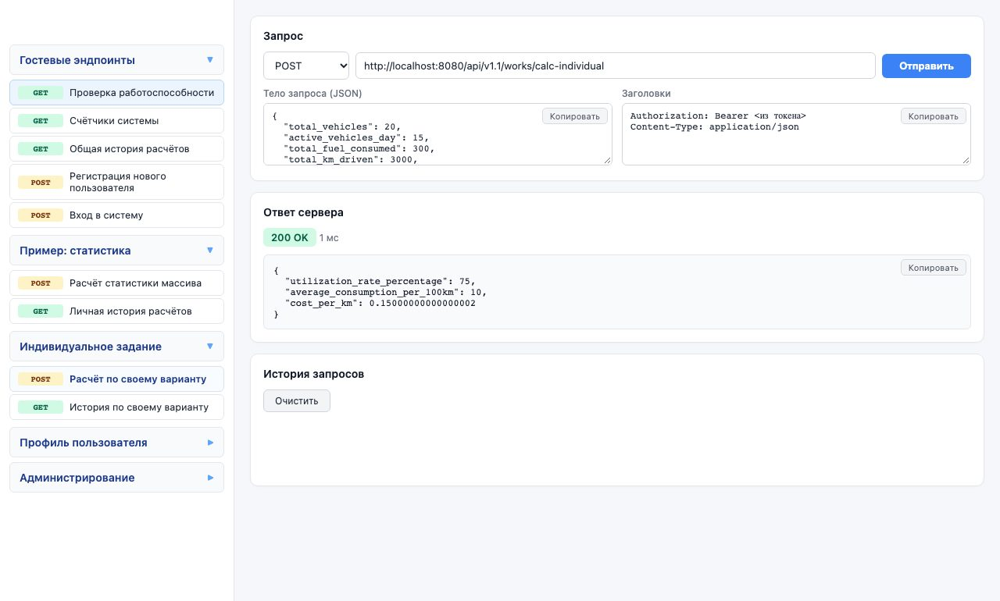

# Fleet Analytics REST API

A C++17 coursework project that calculates fleet utilization, fuel consumption per 100 km, and fuel cost per kilometre. It includes a browser API console and stores successful calculations in SQLite.



## Quick start

Install a C++17 compiler, CMake, and SQLite. Run from the repository root.

```sh
cmake -S . -B build
cmake --build build
ctest --test-dir build --output-on-failure
./build/rest_server
```

In a second terminal, run `python3 -m http.server 8093 --bind 127.0.0.1`. Open [the browser console](http://localhost:8093/frontend/index.html), sign in with the local demo account `user1` / `user1`, then select the fleet calculation preset. The server is intended for local demonstrations with disposable data.

## Architecture and contribution

The inherited HTTP server supplies routing, authentication, role checks, and SQLite persistence. This coursework adds [the fleet module](src/modules/individual/variant_mine.hpp), validation for the five required input fields, the browser presets, and the [fleet tests](src/modules/individual/variant_tests.hpp). Successful input and results are recorded through the existing individual-work route.

## API

| Method and path | Purpose |
| --- | --- |
| `GET /health` | Check server availability |
| `POST /api/v1.1/auth/login` | Obtain a bearer token |
| `POST /api/v1.1/works/calc-individual` | Validate input and calculate metrics |
| `GET /api/v1.1/works/history-individual` | Read the signed-in user's individual calculations |
| `GET /api/v1.1/admin/run-tests-individual` | Run fleet checks as admin or owner |

A fleet with 20 vehicles, 15 active vehicles, 300 L of fuel, 3,000 km driven, and a fuel price of 1.50 per litre returns **75% utilization**, **10 L/100 km**, and **0.15 per km**. See the [request contract and demonstration](README_VARIANT_13.md) for fields and error cases.

## Tests

The CMake test target exercises 20 calculation and validation cases. With a server running on a disposable local database, `python3 tests/http_tests.py` runs 70 HTTP checks covering valid and malformed requests, authentication, roles, and history.

## Origin and license

Built as Software Engineering coursework (Variant 13) on top of [mal-corp/rest-c](https://github.com/mal-corp/rest-c). The upstream [MIT license](LICENSE) and [server documentation](README_SERVER.md) are included. The HTTP layer uses cpp-httplib and SQLite.
